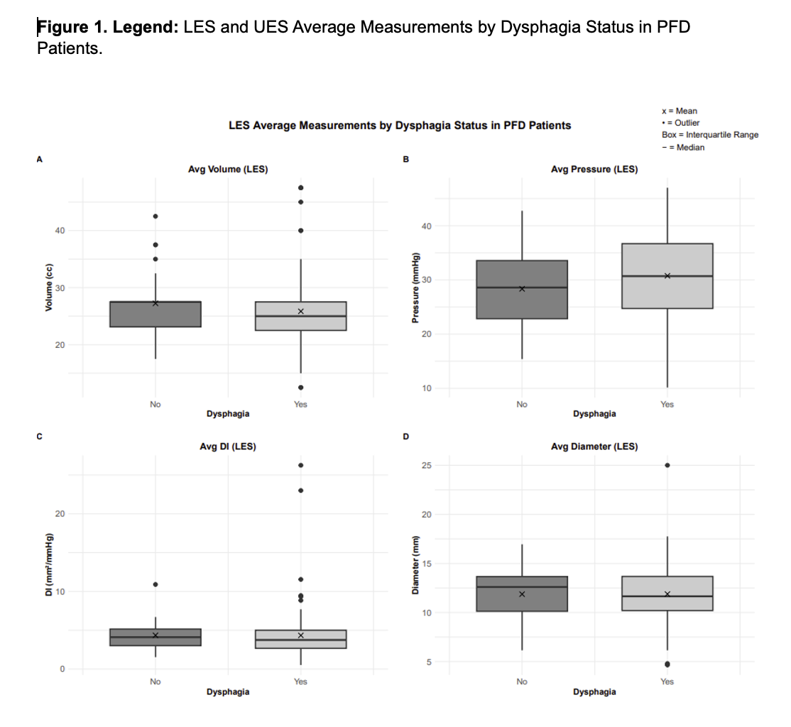
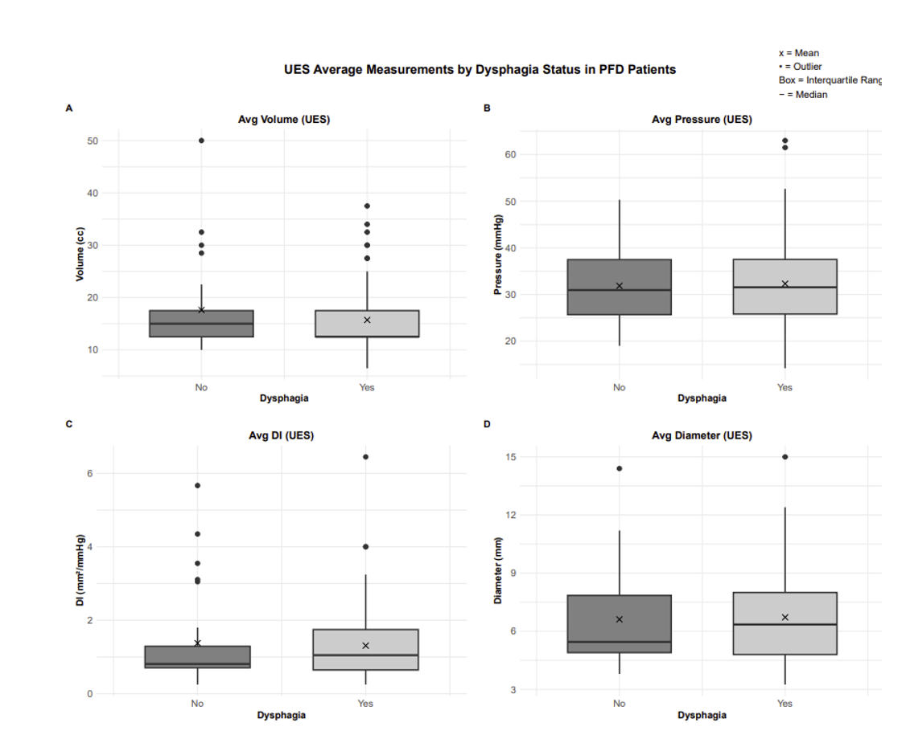

# EndoFLIP Motility Study

### Phoenix Children’s Hospital \| Gastroenterology (2025)

   

------------------------------------------------------------------------

## Overview

This is the **first pediatric study** describing esophageal motility and distensibility using the **Endoluminal Functional Lumen Imaging Probe (EndoFLIP)** in young children with Pediatric Feeding Disorder (PFD).\
The study measured **Upper (UES)** and **Lower Esophageal Sphincter (LES)** parameters and contraction patterns to better understand the esophageal contribution to feeding difficulties.

> **Goal:** Describe and compare patterns of esophageal contraction in children ages 6–72 months with PFD, with and without dysphagia.

------------------------------------------------------------------------

## Study Design

**Type:** Retrospective cohort observational study\
**Population:** 150 children (6 mo–6 yrs) with PFD\
**Period:** Jan 2023 – Jan 2025\
**IRB:** PCH IRB-24-397\
**Procedure:**\
- EGD with EndoFLIP under general anesthesia\
- UES and LES measurements: distensibility index (DI), diameter, pressure, and contraction type\
- Contraction types: RAC (rapid antegrade), RRC (retrograde), absent contractions

**Abnormal values:**\
- LES DI \<3 mm²/mmHg\
- UES DI \<1 mm²/mmHg or decreasing DI with increasing balloon pressure

------------------------------------------------------------------------

## Methods

| Step | Description |
|----|----|
| **Data Collection** | EHR data extraction of demographics, feeding diagnosis, EndoFLIP metrics, and dysphagia status. |
| **Statistical Analysis** | Wilcoxon rank-sum and Fisher’s exact tests for group comparisons. |
| **Software** | SAS 9.4; R 4.1.2 (tidyverse, ggplot2). |
| **Outcome Variables** | LES and UES DI, diameter, pressure, and volume. |

------------------------------------------------------------------------

## Key Results

| Finding                    | Summary                                        |
|----------------------------|------------------------------------------------|
| Sample size                | n = 150 (120 dysphagia, 30 non-dysphagia)      |
| Inadequate contractions    | 23.5% of patients                              |
| LES restriction            | 7.4% of patients                               |
| UES restriction            | 30.9% of patients                              |
| Median LES DI              | 4.11 mm²/mmHg (no dysphagia), 3.70 (dysphagia) |
| Median UES DI              | 0.81 mm²/mmHg (no dysphagia), 1.04 (dysphagia) |
| Association with dysphagia | Not statistically significant (*p*\>0.05)      |
| Adverse events             | None reported                                  |

------------------------------------------------------------------------

## Visuals

------------------------------------------------------------------------

## What Was Known vs. New

| What Was Known | What Is New |
|----|----|
| EndoFLIP is FDA-approved for children ≥5 years, used for diagnosing esophageal disorders. | EndoFLIP is **safe and feasible in children \<5 years** with PFD. |
| Adult normal values for LES-DI are defined; pediatric values are unknown. | This study provides the **first pediatric normative data** for UES and LES-DI and describes the EndoFLIP protocol for children. :contentReference[oaicite:5]{index="5"} |

------------------------------------------------------------------------

## Interpretation

-   **EndoFLIP** provides meaningful esophageal motility data even in very young children where HRM is not feasible.\
-   About **30%** of PFD patients demonstrated **UES restriction**, a novel finding potentially linked to feeding impairment.\
-   Highlights the **safety, efficiency, and diagnostic value** of EndoFLIP in the pediatric population.

------------------------------------------------------------------------

## Skills Demonstrated

Clinical data cleaning • Non-parametric hypothesis testing • ggplot2 visualization • Manuscript writing for Gastroenterology • Multi-disciplinary collaboration

------------------------------------------------------------------------

## Citation

**Measurement and Patterns of Secondary Esophageal Motility by EndoFLIP in Young Patients with Pediatric Feeding Disorder With and Without Persistent Dysphagia**\
**Authors:** Gurleen Kaur Kahlon, MD¹; Sara Karoli²; Krisha Mansukhani, BS³; Lucia Mirea, PhD³; Ricardo Medina-Centeno, MD¹; Dana I. Williams, MD¹

**Affiliations:**\
¹ Phoenix Children’s Hospital, Phoenix, AZ\
² University of Arizona College of Medicine–Phoenix\
³ Phoenix Children’s Statistician Group

Presented as oral and poster sessions at the [**International Pediatric Feeding Disorder Conference (IPFDC 2025)**](https://www.feedingmatters.org/international-pfd-conference/) and [**Digestive Disease Week (DDW 2025)**](https://ddw.org/); submitted to AGA's Journal *Gasteroenterology (2025)*.
